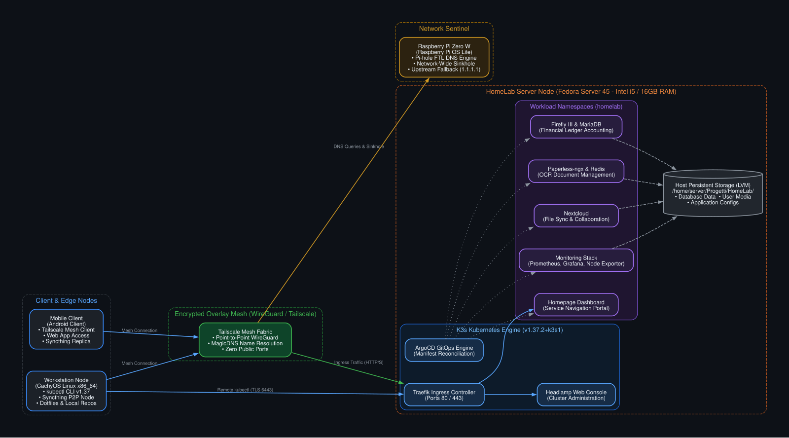
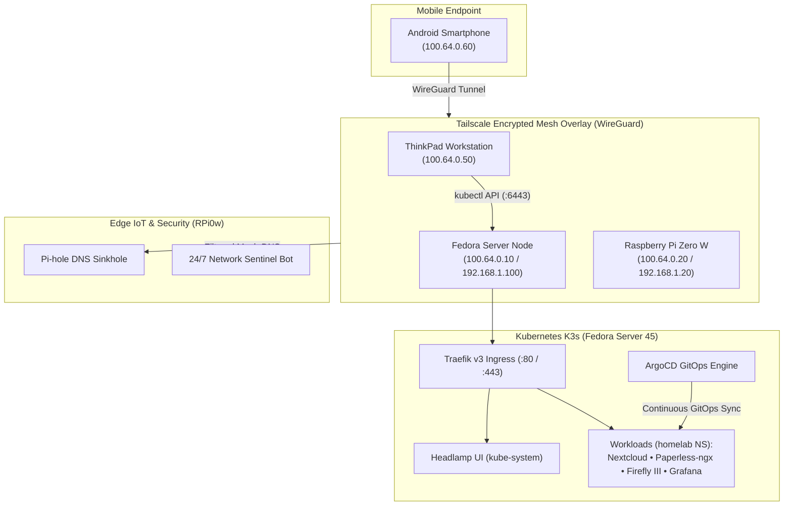

# Personal Multi-Node HomeLab & Kubernetes Cluster

[](https://k3s.io/)
[](https://argoproj.github.io/cd/)
[](https://tailscale.com/)
[](https://fedoraproject.org/)
[](LICENSE)

An enterprise-grade, multi-node homelab infrastructure designed around GitOps automation, self-healing containerized workloads, end-to-end encrypted mesh networking, and custom Telegram bots for mobile operations.

> [!NOTE] Demonstration & Portfolio Reference
> This repository represents a fully functional personal infrastructure. All IP addresses, domain names, credentials, and API tokens have been sanitized with RFC-compliant sample addresses (`192.168.1.100`, `100.64.0.10`) and placeholder secrets for public portfolio showcase.

---

## Architecture Overview



<details>
<summary><b>View Interactive Mermaid Topology</b></summary>



</details>

---

## Physical Hardware Topology

| Node | Hardware Architecture | CPU & Specs | RAM & Storage | Operating System | Primary Responsibilities |
| :--- | :--- | :--- | :--- | :--- | :--- |
| **Fedora Server** | x86_64 Headless Host | Intel Core i5-4200U (2C/4T @ 2.6 GHz) | 16 GB DDR3L<br>240 GB SSD (LVM) | Fedora Server 45 | K3s Control Plane, Traefik Ingress, ArgoCD, Headlamp, Tailscale Exit Node, HostPath Storage. |
| **Workstation** | Lenovo ThinkPad | AMD Ryzen 5 PRO 5650U (6C/12T @ 4.2 GHz) | 16 GB DDR4<br>512 GB NVMe | CachyOS Linux | Primary development, `kubectl` administration, dotfiles repo, AIbot bridge. |
| **Sentinel IoT** | Raspberry Pi Zero W | ARMv6l Single-Core @ 1.0 GHz | 512 MB LPDDR2<br>32 GB MicroSD | Raspberry Pi OS Lite | 24/7 Network Sentinel (ARP monitor & anti-flapping), Pi-hole DNS sinkhole (< 1W power). |
| **Mobile Client**| Smartphone | Octa-Core Processor | 12 GB RAM<br>512 GB Storage | Android 14 / 15 | Telegram 4-bot interface, Obsidian Mobile vault (Syncthing P2P), direct webapp access. |

---

## Core Infrastructure Pillars

### 1. Kubernetes (K3s) & GitOps Engine (ArgoCD)
- **K3s Runtime**: Low-overhead CNCF-certified Kubernetes using embedded SQLite Kine and containerd.
- **ArgoCD GitOps**: Automated reconciliation tracking `k8s-manifests/` on branch `main` with self-healing (`selfHeal: true`).
- **Headlamp Dashboard**: Web UI exposed on Traefik Ingress root path `/` for cluster health, live pod logs, and browser-embedded terminals.
- **Service Workloads**:
  - **Paperless-ngx**: Document processing, OCR, and Redis cache.
  - **Nextcloud**: Self-hosted file collaboration and storage.
  - **Firefly III & Importer**: Personal finance management with MariaDB 10.11 backend.
  - **Homepage**: Custom service launchpad and system metrics widgets.
  - **Monitoring Stack**: Prometheus TSDB, Grafana dashboards, and Node Exporter DaemonSet.

### 2. Network Mesh & Hardened Security
- **Tailscale Mesh Overlay**: Zero public inbound ports opened on the gateway router. All inter-node traffic uses authenticated WireGuard tunnels.
- **Authenticated Exit Node**: Fedora Server routes remote mobile traffic securely through home fiber when connected to untrusted public Wi-Fi.
- **Centralized DNS Filtering**: Raspberry Pi Zero W operates Pi-hole as upstream DNS for all mesh clients with Cloudflare fallback (`1.1.1.1`).
- **Peer-to-Peer Data Sync**: Continuous, bidirectional vault synchronization via Syncthing (inotify watchers, systemd lingering).
- **High-Speed Transfers**: Headless LocalSend daemon (`localgo.service`) on port 53317 for fast LAN file exchange.

### 3. The 4 Telegram Bots Ecosystem (Mobile DevOps)
- **Bot 1 (AIbot)**: Local workstation LLM bridge with Model Context Protocol (MCP) tool integration.
- **Bot 2 (Docker Admin-Bot)**: Inline interactive buttons to inspect, start, stop, and stream logs for local containers.
- **Bot 3 (Network Sentinel)**: 24/7 ARP scanner on Raspberry Pi Zero W with anti-flapping grace period (10 cycles) to prevent false alerts during smartphone Wi-Fi sleep.
- **Bot 4 (K3s Cluster Admin-Bot)**: Remote cluster management bot (`/power` scale to 0/1, `/pods` status, `/top` CPU/RAM metrics, `/logs`, `/restart`).

---

## Repository Directory Structure

```text
.
├── k8s-manifests/               # Declarative Kubernetes (K3s) manifests for ArgoCD
│   ├── 00-namespaces.yaml       # Namespace definitions (homelab, argocd)
│   ├── 01-secrets.example.yaml  # Secret templates and keys
│   ├── headlamp.yaml            # Web UI deployment, RBAC & Ingress
│   ├── homepage.yaml            # Service dashboard deployment & NodePort
│   ├── nextcloud.yaml           # Collaboration suite deployment & hostPath
│   ├── paperless.yaml           # Document archive, Redis & hostPath
│   ├── firefly.yaml             # Finance app, MariaDB 10.11 & Importer
│   ├── monitoring.yaml          # Prometheus, Grafana & Node-Exporter DaemonSet
│   └── argocd-application.yaml  # ArgoCD application continuous delivery CRD
├── docker/                      # Standalone Docker Compose alternative stack
│   ├── docker-compose.yml       # Unified compose service definition
│   ├── manage.sh                # CLI service control script
│   ├── .env.example             # Environment variable template
│   ├── homepage/config/         # Dashboard layout, services and settings
│   └── monitoring/prometheus/   # Prometheus scrape configurations
├── bots/                        # Mobile DevOps Telegram Bots Suite
│   ├── cluster-bot/             # K3s cluster manager (@YourClusterBot)
│   ├── network-sentinel/        # Raspberry Pi Zero W ARP watchdog
│   └── docker-admin-bot/        # Workstation container control bot
├── dotfiles/                    # Workstation environment and shell overview
├── docs/                        # In-depth technical documentation
│   ├── architecture.md          # Full hardware and topology specifications
│   ├── kubernetes-gitops.md     # K3s, Headlamp, Traefik and Docker vs Kubectl cheatsheet
│   ├── network-and-security.md  # Tailscale mesh, Exit Node, Pi-hole and Syncthing
│   ├── services.md              # Port allocation matrix and storage persistence
│   ├── telegram-bots.md         # 4-Bot architecture and operational workflows
│   └── operations-runbook.md    # Maintenance runbook, backups and incident response
└── LICENSE                      # MIT Open Source License
```

---

## Quick Start (Demonstration Deployment)

### Mode A: Deploying with Kubernetes (K3s) & ArgoCD
1. Apply the cluster namespaces and secret template:
   ```bash
   kubectl apply -f k8s-manifests/00-namespaces.yaml
   kubectl apply -f k8s-manifests/01-secrets.example.yaml
   ```
2. Apply the declarative workload manifests:
   ```bash
   kubectl apply -f k8s-manifests/
   ```
3. Verify workload health:
   ```bash
   kubectl get pods -n homelab
   kubectl get ingress -A
   ```

### Mode B: Standalone Docker Compose
1. Navigate to the `docker/` directory:
   ```bash
   cd docker
   cp .env.example .env
   ```
2. Launch services using the management CLI:
   ```bash
   ./manage.sh start
   ./manage.sh status
   ```

---

## Master Port Allocation Matrix

| Service | Protocol | Scope | Port | Access Endpoint |
| :--- | :--- | :--- | :--- | :--- |
| **Headlamp Dashboard** | HTTP | Ingress (Traefik) | 80 | `http://192.168.1.100/` |
| **ArgoCD Web Console** | HTTP | NodePort | 30200 | `http://192.168.1.100:30200/` |
| **Homepage Portal** | HTTP | NodePort | 30050 | `http://192.168.1.100:30050/` |
| **Nextcloud Suite** | HTTP | NodePort | 30080 | `http://192.168.1.100:30080/` |
| **Paperless-ngx** | HTTP | NodePort | 30082 | `http://192.168.1.100:30082/` |
| **Firefly III** | HTTP | NodePort | 30090 | `http://192.168.1.100:30090/` |
| **Firefly Importer** | HTTP | NodePort | 30091 | `http://192.168.1.100:30091/` |
| **Grafana Telemetry** | HTTP | NodePort | 30030 | `http://192.168.1.100:30030/` |
| **Pi-hole Admin (RPi)**| HTTP | Direct Port | 80 | `http://192.168.1.20/admin/` |
| **Cockpit Host Admin** | HTTPS | Host Port | 9090 | `https://192.168.1.100:9090/` |

---

## Documentation Index

- [Detailed Architecture & Hardware](docs/architecture.md)
- [Kubernetes, Headlamp & GitOps](docs/kubernetes-gitops.md)
- [Network Mesh & Security Hardening](docs/network-and-security.md)
- [Service Inventory & Volume Mounts](docs/services.md)
- [4-Bot Mobile DevOps Suite](docs/telegram-bots.md)
- [Maintenance & Incident Runbook](docs/operations-runbook.md)
