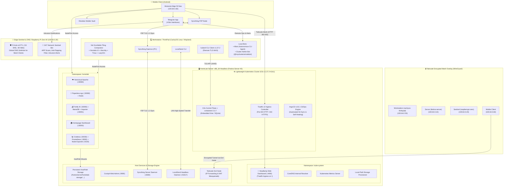

# System Architecture & Hardware Topology

## 1. Architectural Vision

This repository documents a production-grade, multi-node personal infrastructure designed for high availability, self-healing, zero-trust remote access, and automated GitOps continuous reconciliation.

The infrastructure bridges physical servers, developer workstations, low-power edge sentinels, and mobile endpoints across an end-to-end encrypted WireGuard mesh network (Tailscale).

---

## 2. Hardware Topology & Specifications

| Node Identifier | Hardware Architecture | CPU & Specs | RAM & Storage | Operating System | Network Interfaces | Primary Responsibilities |
| :--- | :--- | :--- | :--- | :--- | :--- | :--- |
| **Fedora Server** (`fedora-server`) | x86_64 Laptop (Headless, Lid Inactive) | Intel Core i5-4200U (2C/4T @ 2.6 GHz) | 16 GB DDR3L RAM 240 GB SSD (LVM ext4) | **Fedora Server 45** (Linux Kernel 6.17+) | LAN: `192.168.1.100` Tailscale: `100.64.0.10` | K3s Control Plane & Worker, ArgoCD GitOps, Traefik Ingress, Headlamp UI, Cockpit, Tailscale Exit Node, Persistent Storage. |
| **Workstation** (`cachyos-thinkpad`) | Lenovo ThinkPad Laptop | AMD Ryzen 5 PRO 5650U (6C/12T @ 4.2 GHz) | 16 GB DDR4 RAM 512 GB NVMe SSD | **CachyOS Linux** (BORE scheduler, Wayland/Niri) | Wi-Fi (DHCP) Tailscale: `100.64.0.50` | Primary development workstation, `kubectl` administration, dotfiles repository, local AIbot, Syncthing peer. |
| **Network Sentinel** (`raspberrypi`) | Single-board Computer (SBC) | Broadcom BCM2835 ARMv6l single-core @ 1.0 GHz | 512 MB LPDDR2 RAM 32 GB Class 10 MicroSD | **Raspberry Pi OS Lite** (Debian Bullseye, 32-bit) | Wi-Fi: `192.168.1.20` Tailscale: `100.64.0.20` | 24/7 Network Sentinel (ARP discovery & anti-flapping), Pi-hole DNS sinkhole across Tailscale mesh (< 1 Watt power draw). |
| **Mobile Endpoint** | Smartphone | Octa-Core Processor | 12 GB RAM 512 GB Storage | **Android 14 / 15** | Mobile 5G / Wi-Fi Tailscale: `100.64.0.60` | Remote mobile terminal: Telegram bots interface, Obsidian Mobile vault, webapp browser access. |

> [!NOTE] Architectural Note on Raspberry Pi Zero W (ARMv6l)
> The Raspberry Pi Zero W utilizes the ARMv6l instruction set. Standard Kubernetes and K3s binaries require `armv7` or `aarch64` architectures; attempting to execute K3s on ARMv6 generates an `Illegal instruction` kernel fault. Consequently, the Pi Zero W operates as a dedicated, low-power IoT sentinel and DNS sinkhole, while the K3s cluster runs on the x86_64 server node.

---

## 3. Storage Hierarchy & Data Persistence

Workloads running inside the Kubernetes cluster achieve persistence via `hostPath` bindings mapped directly to the server filesystem under `/home/server/homelab-storage/`:

- **Nextcloud**: Application core files and document libraries (`nextcloud/html`) with ownership set to `www-data` (`UID:GID 33:33`).
- **Paperless-ngx**: Extracted metadata (`paperless/data`), original scanned media (`paperless/media`), automatic consumption directory (`paperless/consume`), and export archive (`paperless/export`).
- **Firefly III**: Relational database persistence under MariaDB 10.11 (`firefly/db_data`) with initial SQL schema import.
- **Monitoring**: Time-series metrics retention under Prometheus TSDB (`monitoring/prometheus_data`) and Grafana user dashboards (`monitoring/grafana_data`).
- **Homepage**: Declarative dashboard YAML declarations (`homepage/config`).
