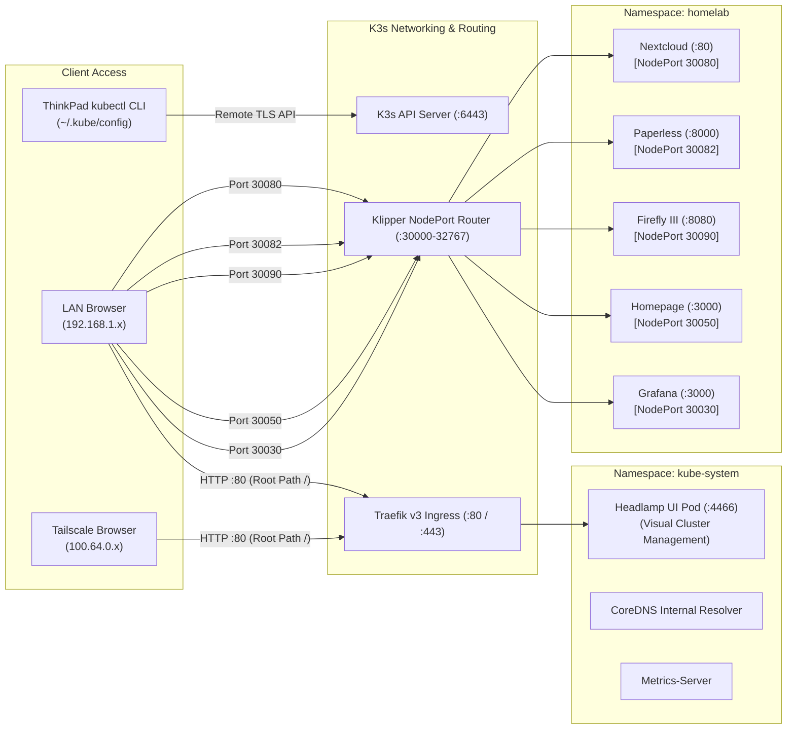

# Kubernetes Cluster & GitOps Architecture

## 1. K3s Lightweight Cluster Specifications

The server executes a CNCF-certified lightweight Kubernetes distribution (**K3s v1.37.2+k3s1**) configured with `containerd 2.3.7`:

- **Low-Overhead Control Plane**: Employs an embedded Kine translation layer backed by SQLite instead of an external etcd cluster, cutting baseline memory consumption to under 500 MB.
- **TLS Subject Alternative Names (SANs)**: Cluster TLS certificates are issued with SAN entries for both LAN (`192.168.1.100`) and Tailscale mesh IP (`100.64.0.10`), eliminating hostname mismatch warnings during remote `kubectl` access.
- **Fedora 45 iptables Compatibility**: Fedora 45 defaults to `nftables v1.8.13`, which exhibits commit latency with K3s flannel CNI rules. K3s is linked against `iptables-legacy` via system alternatives, guaranteeing reliable pod networking.
- **Network CIDRs**:
  - Pod Subnet: `10.42.0.0/16` (CNI bridge `cni0` and Flannel overlay `flannel.1`)
  - Service Subnet: `10.43.0.0/16`
  - NodePort Range: `30000-32767` permanently permitted through host firewall rules.

---

## 2. Cluster Dashboard: Headlamp Web Console

Rather than relying strictly on command-line terminal tools (such as `k9s`), the cluster integrates **Headlamp** (`ghcr.io/headlamp-k8s/headlamp`):

- **Zero Dedicated Port Overhead**: Bound to the native Traefik Ingress controller on root path `/` (port 80 HTTP / 443 HTTPS).
- **Negligible Footprint**: Operates with ~13 MB RAM and < 2 millicores of CPU.
- **Integrated Capabilities**:
  - Real-time CPU, Memory, and Disk I/O telemetry charts for nodes and pods.
  - Live log streaming with regex filtering.
  - One-click interactive container shells (`bash`/`sh`) embedded directly inside the browser.
  - Workload lifecycle actions (pod rolling restarts, scaling, eviction inspection).
- **Authentication**: Authenticates using a 256-bit cryptographic Bearer Token linked to the cluster administrator ServiceAccount `headlamp-admin`.

---

## 3. GitOps Continuous Delivery: ArgoCD

All workload configurations in `k8s-manifests/` are governed by **ArgoCD v3.6.1**, serving as the single declarative source of truth:

- **Namespace**: `argocd`
- **Dashboard URL**: `http://192.168.1.100:30200` (LAN) / `http://100.64.0.10:30200` (Tailscale)
- **Tracked Repository**: `https://github.com/your-username/HomeLab-cluster.git`
- **Reconciliation Engine**: Automated reconciliation with `selfHeal: true`. If a pod or deployment is modified manually or undergoes configuration drift, ArgoCD automatically reconciles the runtime state back to the Git declaration within seconds.
- **Developer Workflow**:
  1. Edit manifests in `k8s-manifests/` on the local workstation.
  2. Execute `git commit` and `git push origin main`.
  3. ArgoCD triggers automated validation, detects the delta, and deploys the update with zero human server intervention.

---

## 4. Operational Cheatsheet: Docker Compose vs. Kubectl

| Action / Operation | Traditional Docker Compose | Kubernetes (K3s) with Kubectl |
| :--- | :--- | :--- |
| **List active workloads** | `docker compose ps` | `kubectl get pods -n homelab` |
| **Inspect all cluster workloads** | `docker ps -a` | `kubectl get pods -A` |
| **Stream real-time logs** | `docker compose logs -f <service>` | `kubectl logs -n homelab -l app=<service> -f` |
| **Inspect last 50 log lines** | `docker compose logs --tail=50 <service>` | `kubectl logs -n homelab -l app=<service> --tail=50` |
| **Rolling restart of a workload** | `docker compose restart <service>` | `kubectl rollout restart deployment/<service> -n homelab` |
| **Scale down workload to zero** | `docker compose stop <service>` | `kubectl scale deployment/<service> -n homelab --replicas=0` |
| **Scale up workload to one replica** | `docker compose up -d <service>` | `kubectl scale deployment/<service> -n homelab --replicas=1` |
| **Open container interactive shell** | `docker exec -it <container> bash` | `kubectl exec -n homelab -it deploy/<service> -- bash` |
| **Inspect live memory and CPU usage** | `docker stats` | `kubectl top pods -n homelab` |
| **Inspect host resource usage** | `htop` via SSH | `kubectl top nodes` |
| **Investigate container failure events**| `docker inspect <container>` | `kubectl describe pod <pod-name> -n homelab` |
