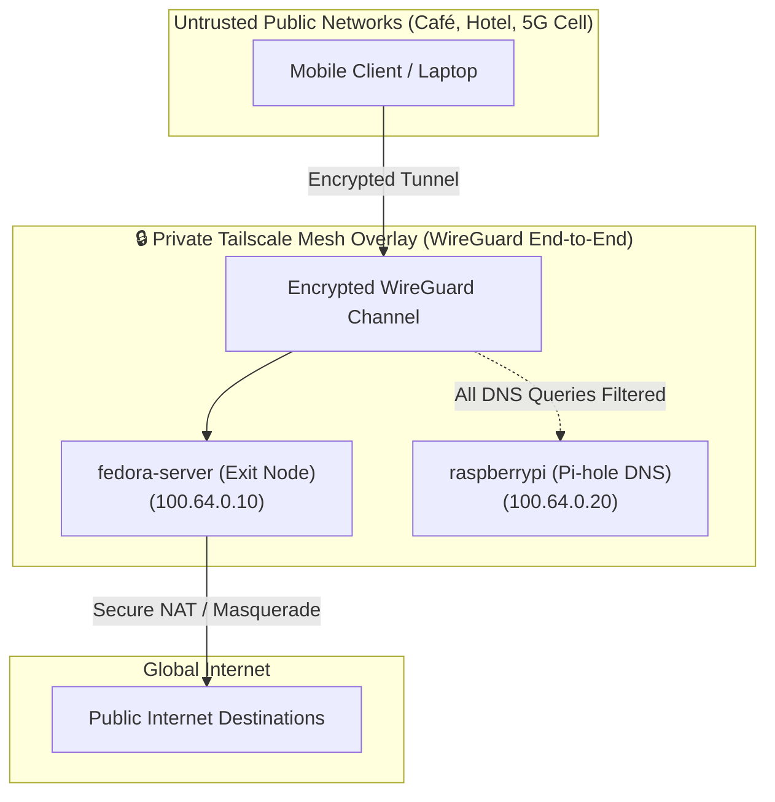

# Network Architecture & Security Hardening

## 1. Zero-Trust Mesh Network: Tailscale WireGuard

Every physical and mobile device within the ecosystem participates in a private, WireGuard-encrypted mesh network (Tailscale):

- **Zero Inbound Port Forwarding**: The edge router has no forwarded ports; perimeter firewalls remain completely closed to inbound Internet scanning.
- **Cryptographic Device Verification**: Inter-node handshakes leverage asymmetric WireGuard public-key cryptography.
- **MagicDNS**: Internal service discovery resolves hostnames (`fedora-server`, `cachyos-thinkpad`, `raspberrypi`) directly across the mesh overlay.



---

## 2. Secure Routing: Fedora Server Exit Node

The Fedora Server operates as an authenticated Tailscale Exit Node, allowing client devices to tunnel all Internet traffic through the secure home fiber link when connected to untrusted public networks:

### Kernel Configuration (`/etc/sysctl.d/99-tailscale.conf`)
```ini
net.ipv4.ip_forward = 1
net.ipv6.conf.all.forwarding = 1
```

### Firewall Routing Rules (Firewalld)
```bash
# Enable IP masquerading on the external interface
sudo firewall-cmd --zone=FedoraServer --add-masquerade --permanent

# Permit WireGuard UDP encapsulation
sudo firewall-cmd --zone=FedoraServer --add-port=41641/udp --permanent
sudo firewall-cmd --reload
```

---

## 3. Network-Wide DNS Sinkhole: Pi-hole on Raspberry Pi Zero W

The Raspberry Pi Zero W node (`100.64.0.20`) acts as a dedicated **DNS Sinkhole** for the entire Tailscale mesh network:

- **Zero Domestic Router Disruption**: The domestic ISP router remains completely stock; other household devices are untouched.
- **Mesh-Wide Protection**: In the Tailscale Admin Console, `100.64.0.20` is designated as the primary nameserver with **"Override local DNS"** enabled. All mesh-connected smartphones, laptops, and servers automatically benefit from ad, tracker, and malware blocking.
- **Resilient Fallback**: Upstream fallback resolvers (`1.1.1.1` and `1.0.0.1`) are configured. If the Raspberry Pi undergoes maintenance, DNS resolution seamlessly fails over without dropping connection.
- **Web Console**: `http://192.168.1.20/admin` (LAN) or `http://100.64.0.20/admin` (Tailscale).

---

## 4. Continuous Peer-to-Peer Data Synchronization: Syncthing

Application documentation, notes, and personal data are replicated across nodes via **Syncthing**:

- **Mesh Topology**: Workstation (`cachyos-thinkpad`), Mobile (`Motorola Edge 50 Neo`), and Server (`fedora-server`).
- **Direct High-Speed Transport**: Communicates directly over port `22000` (QUIC / TLS 1.3) via LAN and Tailscale interfaces with zero cloud intermediary dependencies.
- **System Lingering**: Linux lingering is enabled (`loginctl enable-linger $USER`) to ensure syncthing daemons continue running after terminal logout.
- **Kernel Inotify Watchers**: File modifications are instantly captured at the Linux kernel level with a 10-second debounce safety timer to avoid write collisions.

---

## 5. Headless Local High-Bandwidth Transfer: LocalSend (`localgo`)

For multi-gigabyte backup and asset transfers across LAN (e.g., database dumps, media libraries):

- **Daemon Binary**: `localgo` (LocalSend CLI daemon).
- **System Service**: Managed by systemd (`localgo.service`) on port `53317` with auto-accept configured to save directly into `~/Downloads`.
- **Throughput**: Achieves full line-rate gigabit LAN speeds (> 25 MB/s).
