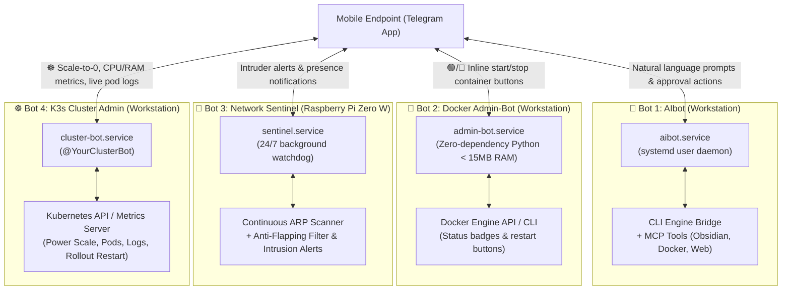

# Telegram Bots Ecosystem (Mobile DevOps)

## 1. Ecosystem Overview

Mobile administration does not require opening manual SSH sessions or exposing terminal ports to the Internet. The infrastructure is governed by **4 specialized Telegram bots**, each handling distinct operational responsibilities:

---

## 2. Bot Profiles & Functional Breakdown

### 🤖 Bot 1: AIbot (Autonomous Development Assistant)
- **Host**: ThinkPad Workstation
- **Role**: AI assistant and pair-programming bridge directly on the workstation.
- **Architecture**: Async `aiohttp` event loop connected via bidirectional IPC pipe to local agentic CLI engines.
- **Capabilities**:
  - Receives natural language tasks and technical queries from mobile.
  - Interactive multi-choice question parser: transforms AI questions into clickable inline Telegram buttons.
  - Interacts with local tools via Model Context Protocol (MCP) servers (Obsidian Vault, local Docker, web searches).

### 🐳 Bot 2: Docker Admin-Bot (Container Manager)
- **Host**: ThinkPad Workstation
- **Role**: Mobile container control panel for local development containers.
- **Footprint**: Written in pure Python standard library (< 15 MB RAM).
- **Capabilities**:
  - Live container status indicators (`🟢 Running`, `🔴 Stopped`).
  - Interactive inline action buttons to start, stop, or restart containers.
  - In-chat log streaming without terminal access.
  - Fast URL generator for WireGuard and LAN endpoints.

### 📡 Bot 3: Network Sentinel (IoT Intrusion Watchdog)
- **Host**: Raspberry Pi Zero W (`100.64.0.20`)
- **Role**: 24/7 local wireless and wired network watchdog.
- **Footprint**: Single-core ARMv6, consumes < 15 MB RAM, power draw < 1 Watt.
- **Capabilities**:
  - Periodic ARP discovery across the subnet.
  - **Anti-Flapping Filter with Grace Period**: Prevents false disconnect alarms caused by modern smartphone Wi-Fi power-save sleep states by requiring 10 consecutive missed scans before marking an endpoint offline.
  - **Intrusion Alerts**: Instantly notifies administrators if an unknown MAC address joins the network.
  - Commands: `/check_wifi`, `/devices_nearby`, `/status`.

### ☸️ Bot 4: K3s Cluster Admin-Bot (Kubernetes Remote Manager)
- **Host**: ThinkPad Workstation / Server
- **Role**: Remote cluster administration, observability, and power management.
- **Key Capabilities**:
  - **🔌 Power Management (`/power`)**:
    - `🛑 SCALE TO 0`: Instantly scales non-essential application deployments in `homelab` to 0 replicas, freeing server CPU and RAM.
    - `▶️ SCALE TO 1`: Restores all webapps and database dependencies in sequence.
    - `🎛️ Individual Workloads`: Single-tap toggles for specific deployments (`Nextcloud`, `Paperless`, `Firefly`, `Grafana`, etc.).
  - **📊 Live Pod Telemetry (`/pods`)**: Status badges, restart counters, container ages, and namespace switching.
  - **⚡ Resource Consumption (`/top`)**: Real-time CPU and Memory utilization per node and per pod.
  - **🔄 Rolling Restarts (`/restart`)**: Zero-downtime rolling deployment restarts.
  - **📜 Container Logs (`/logs`)**: Streams recent container log lines directly into Telegram chat.
  - **⚠️ Cluster Event Stream (`/events`)**: Instant diagnostic views of warnings, failed health probes, or image pull issues.

---

## 3. Security Model

- **Telegram User ID Whitelist**: Every bot strictly validates `from_user.id` on incoming updates.
- **Zero Public Ingress**: Bots connect outward to Telegram API servers via HTTPS long-polling (`getUpdates`). No inbound webhook ports are exposed.
- **Sanitized Secrets**: Bot tokens and user ID whitelists are stored strictly in ignored configuration files (`config.json`).
